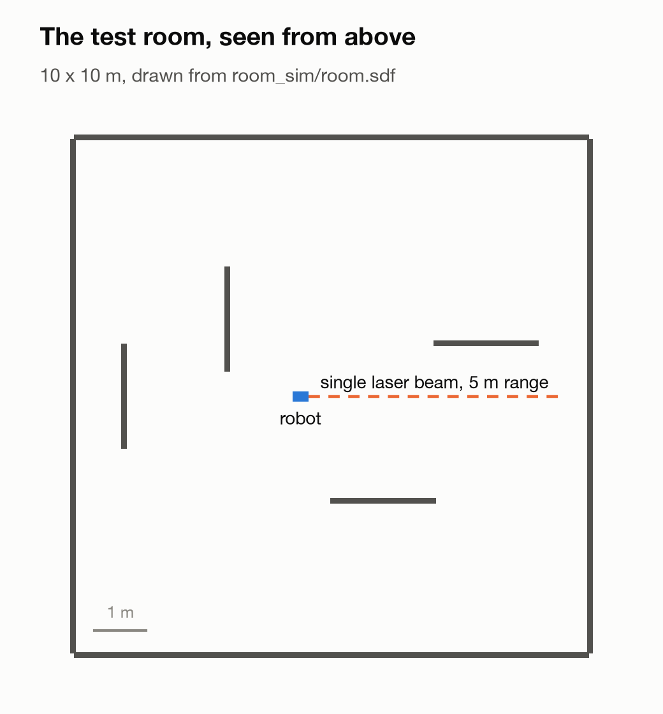
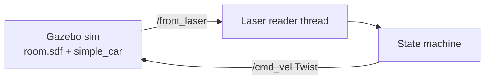
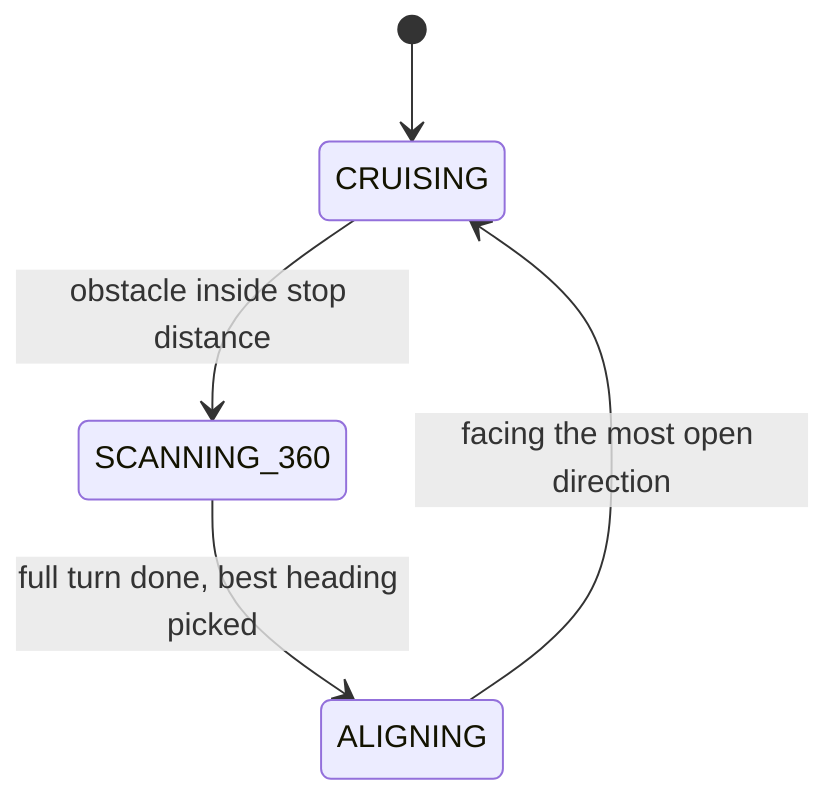

# autonomous-car-simulation-gazebo

I made a little robot that drives itself around a room in Gazebo without crashing into the walls, using a single forward-facing laser beam.

## The problem

Real robot vacuums navigate with a spinning lidar or a camera. I wanted to know how far the cheapest possible sensor goes: a single range reading straight ahead. One beam tells you when to stop, but it says nothing about where to go next.

## What I built

- A Gazebo world: a 10 x 10 m room with outer walls and four inner wall segments
- A four-wheel differential-drive robot model (30 x 20 cm) with a one-sample lidar on its nose, range 2 cm to 5 m
- `wall_stop.py`: drives at a wall and stops 10 cm from it
- `wall-roam.py`: roams the room forever

<picture>
  <source media="(prefers-color-scheme: dark)" srcset="docs/room_map_dark.png">
  
</picture>

## Architecture





The controllers are plain Python. They talk to the simulator through the `gz topic` command line tool: one long-lived subprocess echoes `/front_laser` and a background thread parses the latest range out of it, and velocity commands are published to `/cmd_vel` as `gz.msgs.Twist`.

## Design decisions

- The robot is its own lidar turntable. When it is blocked it spins a full 360 degrees at a known angular speed and logs a (time, range) pair on every loop, which turns one beam into a full scan. The angle of each reading is elapsed time multiplied by angular velocity.
- The scan is smoothed with a 5-sample moving average before picking the farthest reading, so a single ray slipping through a gap between two walls doesn't win.
- It turns the short way. After the scan it compares the chosen angle with its complement and rotates in whichever direction is shorter.
- Speed ramps down before the stop. Cruise speed is halved 60 cm before the stop distance and quartered at 30 cm. `wall_stop.py` does the same thing with a proportional law, speed = k x (distance - stop distance).
- Stale data means stop. If no laser reading arrived for a second, the distance is treated as zero. A robot that has lost its sensor should not keep driving on the last good value.
- Stop commands can't be dropped. Normal publishes skip a cycle if the previous `gz topic` call is still running, but a stop kills the in-flight command and sends zero velocity three times synchronously.

## Setup

Needs a recent Gazebo with the `gz` command (Garden or Harmonic) and Python 3. There are no Python dependencies.

Start the simulation from the repo root and press play:

```bash
GZ_SIM_RESOURCE_PATH=room_sim/models gz sim room_sim/room.sdf
```

Then, in a second terminal:

```bash
python3 wall-roam.py
```

or

```bash
python3 wall_stop.py
```

Ctrl+C stops the robot and exits.

The laser reader wraps `gz topic` in `script -q /dev/null` to get line-buffered output. That is the macOS form of the command. On Linux the same command is spelled `["script", "-q", "-c", f"gz topic -e -t {self.topic}", "/dev/null"]`, so change the list in `LaserReader._run` (and `LaserStreamReader.__init__` in `wall_stop.py`).

## Limits

- Heading during the scan is dead reckoning from time, so wheel slip shifts the chosen direction by a few degrees.
- Publishing through a subprocess caps the command rate. A proper transport binding (gz-transport or ROS 2) is the next step.
